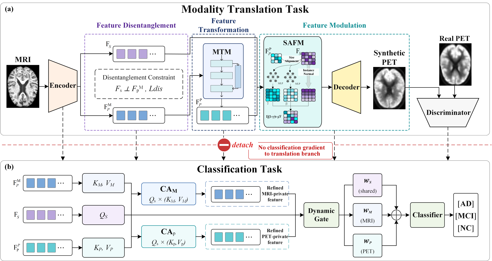

## D²L-Net: Dual-Optimization Disentangled Learning for Robust T1-to-PET Generation and Missing-Modality Alzheimer’s Disease Diagnosis

This repository contains the code for the paper "D²L-Net: Dual-Optimization Disentangled Learning for Robust T1-to-PET Generation and Missing-Modality Alzheimer’s Disease Diagnosis".

### Abstract

Missing positron emission tomography (PET) scans limit multimodal Alzheimer's disease (AD) diagnosis when models require complete MRI-PET pairs. Existing approaches either synthesize PET before diagnosis or jointly optimize synthesis and classification, which can prioritize image fidelity over reusable diagnostic features or create competing gradients. We propose D²L-Net, a dual-optimization disentangled learning framework for T1-to-PET synthesis and missing-modality AD diagnosis. The translation branch separates MRI-derived representations into modality-shared and modality-private components, maps MRI-private information into a PET-oriented representation and transfers gradient-detached latent features to a diagnosis-specific classifier. CenterCross Attention then refines MRI-private and synthesized PET-private features around the shared anatomical representation before adaptive fusion. Across 861 paired T1-PET scans from ADNI, AIBL, and NACC, D²L-Net achieved SSIM values of 70.34%, 61.02% and 61.09%, respectively, and improved SSIM by up to 3.5% over representative joint-learning baselines. On the ADNI three-class task, the classifier achieved 63.65% accuracy, 63.72% recall and 66.93% precision, improving over MedMamba by 3.22, 3.21 and 4.05 percentage points. Ablation, branch-zeroing, t-SNE and gating-weight analyses support the contributions of disentangled feature reuse and center-guided adaptive fusion. These findings suggest that task-decoupled feature reuse can support AD diagnosis when PET is unavailable.

### Highlights

* We introduce D²L-Net, a task-decoupled framework for AD diagnosis from T1-weighted MRI when PET is missing. The framework separately optimizes T1-to-PET translation and disease classification, while transferring translation-derived latent features through gradient detachment. This design preserves stable PET reconstruction and allows the classifier to use structured cross-modal representations without updating the translation branch through classification loss;
* We design a disentangled MRI-to-PET translation branch. The branch separates MRI-derived features into modality-shared and modality-private components. The shared component preserves cross-modal anatomical context, whereas the private component is mapped into a PET-oriented representation for reconstruction across FDG-PET, 11C-PIB-PET and 18F-AV1451 PET;
* We introduce CenterCross Attention for AD diagnosis. The shared feature serves as an anatomical anchor for refining MRI-private and synthesized PET-private features. These refined features are then integrated by instance-aware gated fusion, enabling subject-specific weighting of structural and PET-oriented information.

### Source code

The source code will be uploaded after the paper is accepted.

